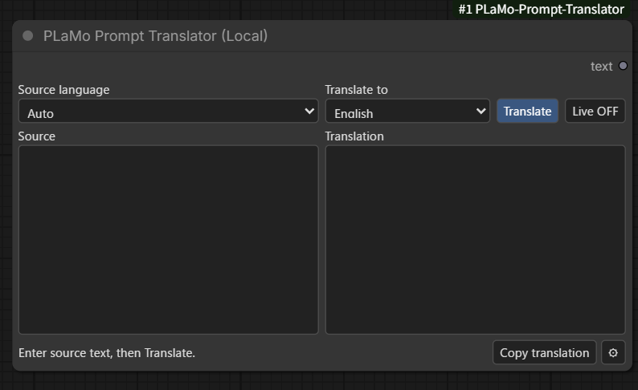
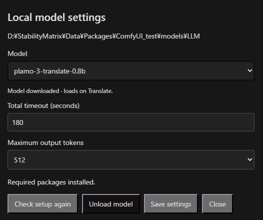
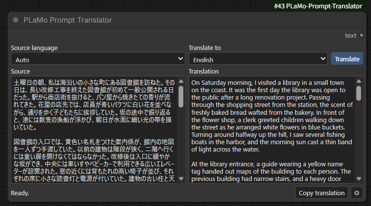
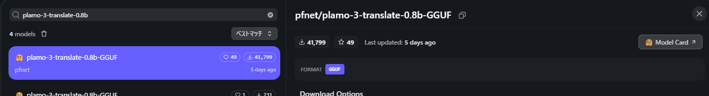
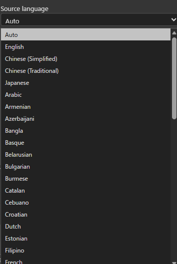

[日本語](#japanese) · [Download v1.2.1](https://github.com/ukr8b3g-cmyk/ComfyUI-PLaMo-Prompt-Translator/releases/tag/v1.2.1) · [Validation](#test-and-verify)

# PLaMo Prompt Translator for ComfyUI

Translate prompts and plain text with **PLaMo 3 Translate 0.8B**. Edit the source and translation side by side, then pass the result to another node as a **STRING**.

## What's new

- **v1.2.1** checks the Local node's Transformers version before downloading or loading the model. If an update is required, the gear menu shows the installed and minimum versions and gives you a command to copy.
- **v1.2.0** added **PLaMo Prompt Translator (Local)**. It runs PLaMo directly in ComfyUI and can download the official model on the first translation. One installation adds both nodes. [Changelog](CHANGELOG.md)

## Choose a node

| Node in ComfyUI | Where translation runs | Model |
| --- | --- | --- |
| [**PLaMo Prompt Translator (Local)**](#use-the-local-node) | In ComfyUI with PyTorch. No LM Studio setup required. | PFN Transformers model, about **1.78 GB**. Downloads on first Translate when missing. |
| [**PLaMo Prompt Translator**](#install-lm-studio-and-download-plamo-lm-studio-node-only) | In LM Studio's local model server. | PFN **GGUF**. The recommended Q4_K_M file is about **573 MB** and is downloaded in LM Studio. |

## Install the custom nodes

### Download the stable ZIP

1. Open the [v1.2.1 release](https://github.com/ukr8b3g-cmyk/ComfyUI-PLaMo-Prompt-Translator/releases/tag/v1.2.1) and download **Source code (zip)**. The ZIP already contains both nodes.
2. Extract it into the folder that ComfyUI uses for custom nodes. Rename the extracted folder to `ComfyUI-PLaMo-Prompt-Translator`. Check that `custom_nodes/ComfyUI-PLaMo-Prompt-Translator/__init__.py` exists. In Windows Portable, the path starts inside the inner `ComfyUI` folder.
3. Restart ComfyUI and reload the browser. Search for **PLaMo Prompt Translator**. Both entries are in **PLaMo / Text**.

### Install from Git

Run these commands in the ComfyUI folder that contains `custom_nodes`. They work in Windows PowerShell and in Linux or macOS terminals with Git installed.

```sh
cd custom_nodes
git clone --branch v1.2.1 https://github.com/ukr8b3g-cmyk/ComfyUI-PLaMo-Prompt-Translator.git ComfyUI-PLaMo-Prompt-Translator
```

This installs the tagged release. The [main branch](https://github.com/ukr8b3g-cmyk/ComfyUI-PLaMo-Prompt-Translator/tree/main) has the latest documentation. The [Comfy Registry entry](https://registry.comfy.org/nodes/comfyui-plamo-prompt-translator) uses the package ID `comfyui-plamo-prompt-translator`.

## Use the Local node



### 1. Check the Python packages

Use the Python that runs ComfyUI. ComfyUI normally already includes PyTorch and Transformers. Accelerate and Numba can vary by installation. The node checks dependencies and supplies a command for you to run to install or update them.

| Package | What to check |
| --- | --- |
| **PyTorch** (`torch`) | Use the build already set up for your ComfyUI installation and hardware. |
| **Transformers** (`transformers`) | Local requires **4.56.0 or later**. An older version can be present even when ComfyUI itself starts. |
| **Accelerate** (`accelerate`) | Needed for Local model loading. Install if the settings say it is missing. |
| **Numba** (`numba`) | Needed by the PFN model. Install if the settings say it is missing. |

Add **PLaMo Prompt Translator (Local)** and open its bottom-right **gear**. **Required packages installed** means you can proceed to the model step. If you see **Waiting for installation** or **Update Transformers**, click **Copy install command** and paste it into a terminal on the computer running ComfyUI. The command selects the actual interpreter, lists only the missing packages and includes the version constraint when Transformers needs updating. Restart ComfyUI after installing the packages.



### 2. Run the install command if needed

The gear menu's command has the correct path for your installation. The following examples install **only Numba**. Run them from the listed starting folder. If the settings identify a different package, use the copied command. Keep quotes around `"transformers>=4.56.0"` so the shell passes the constraint to the package installer.

**Windows PowerShell, venv** (from ComfyUI, for example Stability Matrix)

```powershell
& ".\venv\Scripts\python.exe" -m pip install numba
```

**Windows PowerShell, Portable** (from the folder containing `python_embeded` and `ComfyUI`)

```powershell
& ".\python_embeded\python.exe" -s -m pip install numba
```

**Linux and macOS, venv** (from ComfyUI, with a `.venv` folder)

```bash
./.venv/bin/python -m pip install numba
```

If your environment is named `venv`, use `./venv/bin/python`. In Windows **Command Prompt**, leave off the initial `&` used in the PowerShell examples. The copied Windows command is designed for either shell.

To update **only Transformers**, use the same interpreter. For example, in Windows PowerShell or a Linux/macOS terminal respectively:

```powershell
& ".\venv\Scripts\python.exe" -m pip install "transformers>=4.56.0"
```

```bash
./.venv/bin/python -m pip install "transformers>=4.56.0"
```

If the gear menu gives you a command beginning with `uv pip install`, run it as shown. With ComfyUI Desktop, you can use its built-in terminal. Keep the generated `--python` path so uv installs into ComfyUI's environment. [uv interpreter selection](https://docs.astral.sh/uv/pip/environments/)

If both Accelerate and Numba are missing, use `-m pip install accelerate numba` with the same Python path. To list the installed versions, replace `-m pip install …` with `-m pip show torch transformers accelerate numba`.

### 3. Download the model and translate

1. Paste text into **Source**, select **Translate to**, and click **Translate**. With the default model selected and the required packages installed, the node downloads [PFN's BF16 Transformers checkpoint](https://huggingface.co/pfnet/plamo-3-translate-0.8b) of about **1.78 GB**, loads it, and completes the translation. The status line shows downloading, loading, and translating.
2. The default folder is `ComfyUI/models/LLM/plamo-3-translate-0.8b/`. The exact `LLM` path for your installation appears at the top of the gear menu. Keep `model.safetensors`, the tokenizer, JSON configuration, and PFN model code together. Use the Transformers model here. The GGUF in the next section is for LM Studio.
3. For later translations, the node uses the saved files offline and reuses the loaded model. Use the gear menu's **Unload model** to release it. **Run** still passes the reviewed text to connected nodes.

You can also choose **Download model (1.78 GB)** in the gear menu when the default folder is missing. To download on another machine, run the following from the ComfyUI folder with the [Hugging Face CLI](https://huggingface.co/docs/huggingface_hub/en/guides/cli) installed. It works in PowerShell and Linux/macOS terminals. The revision matches v1.2.1.

```sh
hf download pfnet/plamo-3-translate-0.8b --revision c5a33c561bc6a4fbac38c3460bbb384e15c0b231 --local-dir "./models/LLM/plamo-3-translate-0.8b"
```

Transfer the entire `plamo-3-translate-0.8b` folder to the `LLM` path shown in the destination ComfyUI's gear menu. Click **Check setup again**, select the folder and **Save settings** if needed. If the panel reports an incomplete model, check for an extra folder level and make sure the weight and tokenizer files are present.

The panel uses Japanese when ComfyUI's display language is Japanese. Choose source and target languages separately in the panel.

## Install LM Studio and download PLaMo (LM Studio node only)



1. Download and run the desktop installer for your OS from the [official LM Studio download page](https://lmstudio.ai/download). On Windows, choose **Download LM Studio for Windows** under **Download LM Studio**.
2. In LM Studio, open **Discover** and search for `pfnet/plamo-3-translate-0.8b-GGUF`. Choose the **pfnet** result and download `plamo-3-translate-0.8b-Q4_K_M.gguf` (about 573 MB). [PFN model card](https://huggingface.co/pfnet/plamo-3-translate-0.8b-GGUF) · [LM Studio model download guide](https://lmstudio.ai/docs/app/basics/download-model)

   

3. On the same computer as the ComfyUI backend, open **Model Server** (called **Developer** in some versions) and turn on the server switch. Check that **Status: Running** appears. The default address is `http://127.0.0.1:1234`. [LM Studio server guide](https://lmstudio.ai/docs/developer/core/server)

   

4. In the ComfyUI node, open **Connection settings** using the gear icon. Enter the server URL, click **Refresh models / Check connection**, select the downloaded PLaMo model, and click **Save settings**. Enter an API token if LM Studio has authentication enabled. The first translation loads the selected model if needed.

   

## Translate and use the result

1. Set **Source language** to **Auto** for detection, or choose the source language. Set **Translate to** to the language you want.
2. Paste plain text on the left and click **Translate**. Review or edit the text on the right. **Copy translation** copies it to the clipboard.
3. Connect **text** to a compatible STRING input, such as **Preview as Text** or a **CLIP Text Encode** node with its text widget converted to an input. **Run** passes the accepted text to connected nodes.
4. Use **Use current text** to accept a manually entered or partial translation after reviewing it. The workflow saves the text, languages, and acceptance state. [Example workflow](examples/translator-node.json)

The two node types have separate settings. LM Studio connection settings apply to all LM Studio nodes. Use **Unload selected model** to free the selected LM Studio model. An API token entered in the dialog stays in that browser tab. The ComfyUI server can also read `COMFYUI_PLAMO_API_TOKEN` from its environment.

Translate the natural-language portion of a prompt first. Add LoRA references, weights, wildcards or prompt-control syntax to the edited result.

## Live translation

Click **Live OFF** beside Translate to enable automatic translation. **Live ON** is red; its tooltip explains the action. Translation starts 800 ms after typing stops, after IME composition completes. Only the newest input is translated next; stale replies do not overwrite edits. Click again to turn it off. Errors are not retried continuously. Run still sends the accepted text without starting translation. The switch is saved per node in the workflow; reopening alone does not start translation.

## Long text and token limits

One click on **Translate** sends long text in pieces. Each piece contains up to **2,000 source characters**. The node prefers a paragraph break and falls back to a line, sentence or word boundary where possible. It translates the pieces in order and joins the results. If a piece reaches the token cap, the node can split that piece further and retry. An unresolved cutoff is shown as a partial result for review.

**Maximum output tokens** is the limit per segment, in either node. Choose **256, 512, 1024 or 2048** in the gear menu. The default is **512**. The joined translation can exceed **2048 tokens**. The configured **Total timeout** covers all segments. The Local node downloads the model before starting that timer. The node accepts up to **16,000 source characters (64 KiB UTF-8)** and **64,000 combined result characters (256 KiB UTF-8)**.

In a Windows test with ComfyUI and LM Studio, a 14,098-character English passage produced **2,588 Japanese completion tokens** over eight requests from one Translate click. The complete result reached **Preview as Text** on Run. [Validation details](docs/VALIDATION.md)

## Test and verify

- **Local smoke test**. Add the Local node, enter `窓辺で猫が眠っています。`, select **English**, and click **Translate**. Check that English appears on the right and that **Run** passes the reviewed text to a connected STRING input.
- **Local dependency test**. In an environment with an older Transformers, open the gear menu. The version requirement and update command should be visible before a translation tries to load the model. Leave an up-to-date environment as it is.
- **Automated tests**. From the custom-node repository, use ComfyUI's Python or a development environment with `aiohttp`. Node.js runs the frontend and Live tests.

```sh
python -m unittest discover -s tests -p "test_*.py"
node --test tests/*.mjs
```

v1.2.1 was checked with Transformers **4.50.3** for update guidance and **4.56.0** and **5.23.0** for CPU translation with the official model. [Validation log](docs/VALIDATION.md#local版のtransformers互換性2026-11-20)

## Supported languages

PLaMo 3 Translate supports **53 language choices**. Simplified and Traditional Chinese are separate choices. Hugging Face shows 52 because its language badge groups them together. **Auto** is available for the source. The target is selected explicitly and defaults to **English**. [PFN language list](https://huggingface.co/pfnet/plamo-3-translate-0.8b-GGUF#supported-languages)




| Language | Language | Language |
| --- | --- | --- |
| English `en` | Chinese (Simplified) `zh-hans` | Chinese (Traditional) `zh-hant` |
| Japanese `ja` | Korean `ko` | Arabic `ar` |
| Azerbaijani `az` | Belarusian `be` | Bulgarian `bg` |
| Bengali `bn` | Catalan `ca` | Cebuano `ceb` |
| German `de` | Spanish `es` | Estonian `et` |
| Basque `eu` | Persian `fa` | French `fr` |
| Gujarati `gu` | Hebrew `he` | Hindi `hi` |
| Croatian `hr` | Hungarian `hu` | Armenian `hy` |
| Indonesian `id` | Italian `it` | Javanese `jv` |
| Georgian `ka` | Kazakh `kk` | Khmer `km` |
| Lithuanian `lt` | Latvian `lv` | Malayalam `ml` |
| Marathi `mr` | Malay `ms` | Burmese `my` |
| Nepali `ne` | Dutch `nl` | Punjabi `pa` |
| Polish `pl` | Russian `ru` | Sinhala `si` |
| Slovak `sk` | Slovenian `sl` | Serbian `sr` |
| Swahili `sw` | Tamil `ta` | Telugu `te` |
| Thai `th` | Tagalog `tl` | Urdu `ur` |
| Uzbek `uz` | Vietnamese `vi` |  |

[Latest release](https://github.com/ukr8b3g-cmyk/ComfyUI-PLaMo-Prompt-Translator/releases/latest) · [Change log](CHANGELOG.md) · [API example](examples/translate_api.py) · [References and model license](docs/PROVENANCE.md) · [Forge Neo version](https://github.com/ukr8b3g-cmyk/Forge-Neo-PLaMo-Prompt-Translator)

<a id="japanese"></a>

# 日本語

[英語](#plamo-prompt-translator-for-comfyui) · [v1.2.1をダウンロード](https://github.com/ukr8b3g-cmyk/ComfyUI-PLaMo-Prompt-Translator/releases/tag/v1.2.1) · [動作確認とテスト](#動作確認とテスト)

**PLaMo 3 Translate 0.8B** で画像生成プロンプトや自然文を翻訳できます。原文と訳文を左右に並べ、編集した訳文を **STRING** として次のノードへ渡せます。

## アップデート内容

- **v1.2.1** ではLocal版がモデルの取得・読み込み前にTransformersの版を確認します。古い場合は、歯車の設定画面に現在の版と必要な版が表示され、その環境用の更新コマンドをコピーできます。
- **v1.2.0** で **PLaMo Prompt Translator (Local)** が加わりました。ComfyUI内でモデルを動かし、初回の翻訳時に公式モデルを自動取得できます。1回のインストールで2つのノードが入ります。[変更履歴](CHANGELOG.md)

## 2つのノードの違い

| ComfyUIで表示されるノード名 | 翻訳する場所 | 使うモデル |
| --- | --- | --- |
| [**PLaMo Prompt Translator (Local)**](#local版を使う) | ComfyUI内でPyTorchを使って翻訳します。 | PFN公式のTransformers版。約 **1.78 GB**。未取得なら初回の翻訳で自動ダウンロード。 |
| [**PLaMo Prompt Translator**](#lm-studioとplamoを準備lm-studio版のみ) | 同じPCで起動したLM Studioのモデルサーバーで翻訳します。 | PFN公式の **GGUF**。推奨のQ4_K_Mは約 **573 MB**。LM Studio内でダウンロード。 |

## カスタムノードをインストール

### 正式リリースのZIPを使う

1. [v1.2.1のリリース](https://github.com/ukr8b3g-cmyk/ComfyUI-PLaMo-Prompt-Translator/releases/tag/v1.2.1) を開き、**Source code (zip)** をダウンロードします。ZIPには2つのノードが入っています。
2. 展開したフォルダーをComfyUIの `custom_nodes` に入れ、`ComfyUI-PLaMo-Prompt-Translator` に名前をそろえます。`custom_nodes/ComfyUI-PLaMo-Prompt-Translator/__init__.py` にファイルがあることを確認します。Windows Portableでは、内側の `ComfyUI` フォルダーに `custom_nodes` があります。
3. ComfyUIを再起動し、ブラウザーを再読み込みします。ノード追加画面で **PLaMo Prompt Translator** を検索すると、**PLaMo / Text** に両方が表示されます。

### Gitで入れる

Gitが入っている場合は、`custom_nodes` のあるComfyUI本体のフォルダーで実行します。Windows PowerShell、Linux、macOSで共通です。

```sh
cd custom_nodes
git clone --branch v1.2.1 https://github.com/ukr8b3g-cmyk/ComfyUI-PLaMo-Prompt-Translator.git ComfyUI-PLaMo-Prompt-Translator
```

このコマンドは正式リリースのタグを取得します。最新の説明は[GitHubのmain](https://github.com/ukr8b3g-cmyk/ComfyUI-PLaMo-Prompt-Translator/tree/main)にあります。[Comfy Registry](https://registry.comfy.org/nodes/comfyui-plamo-prompt-translator)のパッケージIDは `comfyui-plamo-prompt-translator` です。

## Local版を使う


### 1. 依存パッケージを確認する

ComfyUIには通常、PyTorchとTransformersが入っています。AccelerateとNumbaは環境によって異なります。ノードは不足分を調べて導入コマンドを表示し、**Pythonパッケージの導入や更新は利用者がコマンドを実行して行います。**

| パッケージ | 確認すること |
| --- | --- |
| **PyTorch**（`torch`） | ComfyUIがすでに使用しているものを使います。GPUやOSに合ったComfyUIの構成を使用します。 |
| **Transformers**（`transformers`） | Local版は **4.56.0以上** が必要です。ComfyUIが起動できる環境でも、これより古い場合があります。 |
| **Accelerate**（`accelerate`） | モデルの読み込みに使います。設定画面に不足と出たときに入れます。 |
| **Numba**（`numba`） | PFNモデルが使います。設定画面に不足と出たときに入れます。 |

**PLaMo Prompt Translator (Local)** を追加し、ノード右下の **歯車** を開きます。**必要なパッケージはインストール済みです** と表示されたらモデルの手順へ進めます。**インストール待ち** または **Transformersを更新** と表示された場合は、**インストールコマンドをコピー** を押します。コピーしたコマンドは、**ComfyUIが動いているPC** のターミナルで実行します。対象のPythonと不足分が指定され、Transformersには必要な版が付きます。導入が終わったらComfyUIを再起動します。


### 2. OS別のインストールコマンド

歯車に出るコマンドには、実際のPythonの場所が入っています。以下は **Numbaだけが不足している場合** の例です。ほかのパッケージが不足している場合は、コピーしたコマンドを使います。`"transformers>=4.56.0"` の引用符は、版の条件をシェルが正しく渡すために必要です。

**Windows PowerShell・venv版**（Stability MatrixなどのComfyUI本体のフォルダーで実行）

```powershell
& ".\venv\Scripts\python.exe" -m pip install numba
```

**Windows PowerShell・Portable版**（`python_embeded` と `ComfyUI` が並ぶフォルダーで実行）

```powershell
& ".\python_embeded\python.exe" -s -m pip install numba
```

**Linux・macOSのターミナル・venv版**（ComfyUI本体に `.venv` がある場合）

```bash
./.venv/bin/python -m pip install numba
```

仮想環境の名前が `venv` なら `./venv/bin/python` を使います。Windowsの **コマンドプロンプト** に手入力する場合は、上のPowerShell例の先頭にある `&` を外します。歯車からコピーしたWindows用コマンドは、どちらのシェルでも使えます。

**Transformersだけを更新する** 場合も、同じ環境のPythonを指定します。Windows PowerShellとLinux・macOSでの例です。

```powershell
& ".\venv\Scripts\python.exe" -m pip install "transformers>=4.56.0"
```

```bash
./.venv/bin/python -m pip install "transformers>=4.56.0"
```

`uv pip install` で始まるコマンドが出る場合は、そのまま実行します。ComfyUI Desktopでは内蔵ターミナルを使えます。`--python` に続くパスが、インストール先のPythonです。[uvのPython環境選択](https://docs.astral.sh/uv/pip/environments/)

AccelerateとNumbaが両方不足している場合は、同じPythonのパスで `-m pip install accelerate numba` を実行します。導入済みの版を調べる場合は、`-m pip install …` の部分を `-m pip show torch transformers accelerate numba` に置き換えます。

### 3. モデルをダウンロードして翻訳する

1. **原文** に文章を入れ、**翻訳先** を選んで **翻訳（Translate）** を押します。依存パッケージがそろい、標準モデルが未取得なら、[PFN公式のBF16版Transformersモデル](https://huggingface.co/pfnet/plamo-3-translate-0.8b)（約 **1.78 GB**）を自動でダウンロードし、読み込んでそのまま翻訳します。ダウンロード、読み込み、翻訳の進み具合はノードに表示されます。
2. 標準の保存先は `ComfyUI/models/LLM/plamo-3-translate-0.8b/` です。実際の `LLM` フォルダーは歯車の上部に表示されます。重みの `model.safetensors`、トークナイザー、設定ファイル、PFNのモデルコードを同じフォルダーに置きます。Local版はこのTransformers形式を使います。GGUFはLM Studio版で使います。
3. 取得後はオフラインでも翻訳でき、すでに読み込んでいるモデルは次の翻訳でも使われます。歯車の **モデルを解放** でメモリから解放できます。解放後も **Run** で確認済みの訳文を接続先に渡せます。

モデルだけを先に入れる場合は、歯車の **モデルをダウンロード（1.78 GB）** を使えます。別のPCなどで用意する場合は、[Hugging Face CLI](https://huggingface.co/docs/huggingface_hub/en/guides/cli) が使えるターミナルで、ComfyUI本体のフォルダーから次を実行します。Windows PowerShell、Linux、macOSで共通です。v1.2.1が使用するモデルの版を指定しています。

```sh
hf download pfnet/plamo-3-translate-0.8b --revision c5a33c561bc6a4fbac38c3460bbb384e15c0b231 --local-dir "./models/LLM/plamo-3-translate-0.8b"
```

`plamo-3-translate-0.8b` フォルダーをそのまま、使用するComfyUIの歯車に表示される `LLM` フォルダーへ移します。**状態を再確認** を押し、必要に応じてモデルを選んで設定を保存します。モデルが見つからない場合は、フォルダーが二重になっていないか、重みやトークナイザーのファイルがそろっているかを確認します。

パネルを日本語にするには、ComfyUIの表示言語で日本語を選びます。原文と訳文の言語はパネル内で個別に選べます。

## LM StudioとPLaMoを準備（LM Studio版のみ）


1. [LM Studio公式ダウンロードページ](https://lmstudio.ai/download) で、使っているOSのデスクトップ版インストーラーをダウンロードして実行します。Windowsでは **Download LM Studio** の **Download LM Studio for Windows** を選びます。
2. LM Studioの **Discover** を開き、`pfnet/plamo-3-translate-0.8b-GGUF` を検索します。配布元が **pfnet** のモデルを選び、`plamo-3-translate-0.8b-Q4_K_M.gguf`（約573 MB）をダウンロードします。[PFNのモデルページ](https://huggingface.co/pfnet/plamo-3-translate-0.8b-GGUF) · [LM Studio公式のモデル取得手順](https://lmstudio.ai/docs/app/basics/download-model)

   

3. ComfyUI本体と同じPCで **Model Server**（バージョンによっては **Developer**）を開き、サーバーのスイッチをオンにします。**Status: Running** を確認してください。接続先の初期値は `http://127.0.0.1:1234` です。[LM Studio公式のサーバー手順](https://lmstudio.ai/docs/developer/core/server)

   

4. ノード右下の **歯車** を開き、接続先を入力します。**モデル一覧更新・接続確認** を押してPLaMoを選び、**設定を保存** します。LM Studioで認証を使っている場合は、APIトークンも入力します。モデルが未ロードなら、初回の翻訳時に読み込みます。

   

## 翻訳して使う

1. **原文の言語** は **自動** のままでも、手動で選んでも使えます。**翻訳先** を指定します。
2. 左に原文を貼って **翻訳** を押します。右の訳文は編集でき、**訳文をコピー** でコピーできます。
3. ノードの **text** 出力を **Preview as Text** や **CLIP Text Encode** の文字列入力に接続します。CLIP Text Encodeの入力欄は必要に応じて入力端子へ変換します。**Run** を押すと採用済みの訳文が接続先に渡ります。[サンプルワークフロー](examples/translator-node.json)
4. 手入力した訳文や途中までの訳文を使う場合は、内容を確認して **現在の訳文を使う** を押します。原文、言語、編集した訳文と採用状態はワークフローに保存されます。

設定はLocal版とLM Studio版で別です。LM Studio版の接続設定は、同じ種類のノードで共通です。モデルを解放する場合は、接続設定の **選択モデルを解放** を使います。設定画面で入力したAPIトークンは、そのブラウザータブ内だけに保持されます。ComfyUI本体の環境変数 `COMFYUI_PLAMO_API_TOKEN` も使えます。

LoRA参照、重み、ワイルドカードなどを含む場合は、自然文部分を先に翻訳し、必要な構文を訳文へ追加してください。

## 自動翻訳

Translateの隣の **Live OFF／自動翻訳 OFF** を押すと自動翻訳がオンになります。オンは赤色で、マウスを重ねると説明が表示されます。入力停止から800ミリ秒後、日本語IMEの変換確定後に翻訳します。待機するのは最新の原文だけで、古い応答で手編集を上書きしません。もう一度押すとオフになり、エラー時に再試行を繰り返すこともありません。Runは採用済みの訳文を渡す処理のままです。オン・オフはノードごとにワークフローへ保存し、開き直しただけでは翻訳しません。

## 2,000文字を超える長文とトークン上限

**翻訳は1回押すだけ**です。原文は**1区間あたり最大2,000文字**で、できるだけ段落の切れ目で分けます。段落だけで収まらない場合は、改行、文、単語の切れ目を使います。区間を順に翻訳して、訳文をひとつに結合します。途中で切れた区間はさらに分けて再翻訳します。それでも切れた場合は、部分訳として確認できます。

歯車の **最大出力トークン数**（256／512／1024／2048、初期値512）は、両ノードとも **分割した各区間の生成上限** です。結合した訳文は**2,048トークンを超えて**出力できます。設定の **全体タイムアウト（秒）** は、分割したすべての区間に適用されます。Local版はモデルのダウンロードが終わってから計測を開始します。原文は最大 **16,000文字（UTF-8で64 KiB）**、結合後の訳文は最大 **64,000文字（UTF-8で256 KiB）** です。

Windowsの実機検証では、14,098文字の英語をTranslate 1回で日本語へ翻訳し、LM Studioへの8リクエストから**計2,588出力トークン**を得ました。Runでも接続先の Preview as Text に同じ全文が渡りました。[検証記録](docs/VALIDATION.md)

## 動作確認とテスト

- **Local版の翻訳**。Localノードに「窓辺で猫が眠っています。」と入力し、翻訳先を **英語** にして **翻訳** を押します。右に英訳が出たら、文字列入力につないで **Run** し、確認した訳文が渡ることを見ます。
- **依存パッケージの確認**。Transformersが古い環境では、歯車に現在の版と必要な版、更新コマンドが表示されます。その状態で翻訳を押してもモデルを読み込む前に更新案内が出ます。
- **自動テスト**。カスタムノードのフォルダーから、ComfyUIのPythonまたは `aiohttp` のある開発環境で実行します。Node.jsでフロントエンドとLiveのテストを実行します。

```sh
python -m unittest discover -s tests -p "test_*.py"
node --test tests/*.mjs
```

v1.2.1では **4.50.3** で更新案内を確認し、**4.56.0** と **5.23.0** の両方でPFN公式モデルをCPUに読み込んで同じ短文を翻訳しました。[検証記録](docs/VALIDATION.md#local版のtransformers互換性2026-11-20)

## 対応言語

PLaMo 3 Translateの**53の言語選択肢**に対応します。中国語の簡体字と繁体字を別々に選べます。Hugging Faceのバッジでは中国語がひとつにまとめられるため、52言語と表示されます。**自動** は原文の言語で選べます。翻訳先の初期値は **英語** です。[PFN公式の対応言語](https://huggingface.co/pfnet/plamo-3-translate-0.8b-GGUF#supported-languages)


| 言語 | 言語 | 言語 |
| --- | --- | --- |
| 英語 `en` | 中国語（簡体字） `zh-hans` | 中国語（繁体字） `zh-hant` |
| 日本語 `ja` | 韓国語 `ko` | アラビア語 `ar` |
| アゼルバイジャン語 `az` | ベラルーシ語 `be` | ブルガリア語 `bg` |
| ベンガル語 `bn` | カタルーニャ語 `ca` | セブアノ語 `ceb` |
| ドイツ語 `de` | スペイン語 `es` | エストニア語 `et` |
| バスク語 `eu` | ペルシャ語 `fa` | フランス語 `fr` |
| グジャラート語 `gu` | ヘブライ語 `he` | ヒンディー語 `hi` |
| クロアチア語 `hr` | ハンガリー語 `hu` | アルメニア語 `hy` |
| インドネシア語 `id` | イタリア語 `it` | ジャワ語 `jv` |
| ジョージア語 `ka` | カザフ語 `kk` | クメール語 `km` |
| リトアニア語 `lt` | ラトビア語 `lv` | マラヤーラム語 `ml` |
| マラーティー語 `mr` | マレー語 `ms` | ビルマ語 `my` |
| ネパール語 `ne` | オランダ語 `nl` | パンジャーブ語 `pa` |
| ポーランド語 `pl` | ロシア語 `ru` | シンハラ語 `si` |
| スロバキア語 `sk` | スロベニア語 `sl` | セルビア語 `sr` |
| スワヒリ語 `sw` | タミル語 `ta` | テルグ語 `te` |
| タイ語 `th` | タガログ語 `tl` | ウルドゥー語 `ur` |
| ウズベク語 `uz` | ベトナム語 `vi` |  |

[最新リリース](https://github.com/ukr8b3g-cmyk/ComfyUI-PLaMo-Prompt-Translator/releases/latest) · [変更履歴](CHANGELOG.md) · [APIの使用例](examples/translate_api.py) · [参考資料とモデルのライセンス](docs/PROVENANCE.md) · [Forge Neo版](https://github.com/ukr8b3g-cmyk/Forge-Neo-PLaMo-Prompt-Translator)
