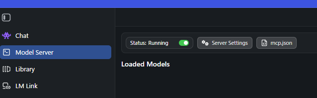
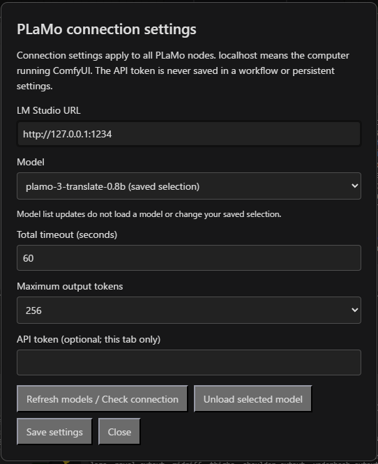
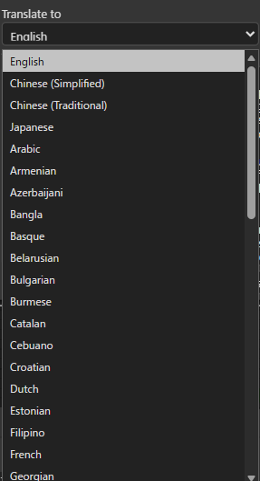

[日本語](#japanese)

# PLaMo Prompt Translator for ComfyUI

Translate image prompts and plain text with **PLaMo 3 Translate 0.8B** in ComfyUI or through LM Studio. Edit the source and translation side by side, then send the result to another node as a **STRING**.


## Install the custom node

Run these commands from the ComfyUI folder that contains `custom_nodes`.

```sh
cd custom_nodes
git clone https://github.com/ukr8b3g-cmyk/ComfyUI-PLaMo-Prompt-Translator.git
```

For a manual install, download the [main branch ZIP](https://github.com/ukr8b3g-cmyk/ComfyUI-PLaMo-Prompt-Translator/archive/refs/heads/main.zip). Extract the folder into `custom_nodes` and name it `ComfyUI-PLaMo-Prompt-Translator`. Its `__init__.py` should be directly inside that folder. Restart ComfyUI, reload the browser tab, and search for **PLaMo Prompt Translator** under **PLaMo / Text**.

The LM Studio node uses ComfyUI's Python environment and `aiohttp`. It requires Python 3.10 or newer.

### Use the Local node

**New in 1.2.0.** Choose **PLaMo Prompt Translator (Local)** to translate inside ComfyUI without starting LM Studio. It uses PFN’s Transformers model, `pfnet/plamo-3-translate-0.8b`. The default download creates `ComfyUI/models/LLM/plamo-3-translate-0.8b/` with the weights (`model.safetensors`), tokenizer, configuration and model code. Keep this folder intact to translate offline on later runs.

1. Add **PLaMo Prompt Translator (Local)**, enter some text and press **Translate**. If the default model is missing, the node downloads the [official BF16 model](https://huggingface.co/pfnet/plamo-3-translate-0.8b) (1.78 GB) to `ComfyUI/models/LLM/`, loads it and translates in the same operation. The status line shows each stage. You can also select an existing model folder in the gear menu.
2. Local inference uses PyTorch, Transformers 4.56.0 or later, Accelerate and Numba. Open the gear menu to see missing packages or a required Transformers update. For an older version, it shows the installed and required versions. Click **Copy install command**. When **✓ Command copied** appears, paste the command into Command Prompt or PowerShell on Windows or a terminal on macOS/Linux **on the computer running ComfyUI**, then press Enter. The command targets that ComfyUI instance's Python, including Portable's bundled Python or a Desktop/venv installation. If the command calls for `uv`, you can use Desktop's built-in terminal. After installation finishes, restart ComfyUI and click **Translate**. The gear menu shows package and model status separately.
3. Use **Translate** or enable **Live**. The first translation loads the model and subsequent translations reuse it. Choose **Unload model** in the gear menu to free it. **Run** sends the reviewed text even after unloading.

The panel uses Japanese when ComfyUI’s language is set to Japanese. Auto and other locales use English. Choose the translation languages separately in the panel.

## Install LM Studio and download PLaMo (LM Studio node only)

1. Download and run the desktop installer for your OS from the [official LM Studio download page](https://lmstudio.ai/download). On Windows, choose **Download LM Studio for Windows** under **Download LM Studio**.
2. In LM Studio, open **Discover** and search for `pfnet/plamo-3-translate-0.8b-GGUF`. Choose the **pfnet** result and download `plamo-3-translate-0.8b-Q4_K_M.gguf` (about 573 MB). [PFN model card](https://huggingface.co/pfnet/plamo-3-translate-0.8b-GGUF) · [LM Studio model download guide](https://lmstudio.ai/docs/app/basics/download-model)

   

3. On the same computer as the ComfyUI backend, open **Model Server** (called **Developer** in some versions) and turn on the server switch. Check that **Status: Running** appears. The default address is `http://127.0.0.1:1234`. [LM Studio server guide](https://lmstudio.ai/docs/developer/core/server)

   

4. In the ComfyUI node, open **Connection settings** using the gear icon. Enter the server URL, click **Refresh models / Check connection**, select the downloaded PLaMo model, and click **Save settings**. Enter an API token if LM Studio has authentication enabled. The first translation loads the selected model if needed.

   

## Translate and use the result

1. Set **Source language** to **Auto** for detection, or choose the source language. Set **Translate to** to the language you want.
2. Paste plain text on the left and click **Translate**. Review or edit the text on the right. **Copy translation** copies it to the clipboard.
3. Connect **text** to a compatible STRING input, such as **Preview as Text** or a **CLIP Text Encode** node with its text widget converted to an input. **Run** passes the accepted text to connected nodes.
4. Use **Use current text** to accept a manually entered or partial translation after reviewing it. The workflow saves the text, languages, and acceptance state. [Example workflow](examples/translator-node.json)

Connection settings apply to all PLaMo nodes. Use **Unload selected model** to free the selected LM Studio model. An API token entered in the dialog stays in that browser tab. The ComfyUI server can also read `COMFYUI_PLAMO_API_TOKEN` from its environment.

Translate the natural-language portion of a prompt first. Add LoRA references, weights, wildcards or prompt-control syntax to the edited result.

## Live translation

Click **Live OFF** beside Translate to enable automatic translation. **Live ON** is red; its tooltip explains the action. Translation starts 800 ms after typing stops, after IME composition completes. Only the newest input is translated next; stale replies do not overwrite edits. Click again to turn it off. Errors are not retried continuously. Run still sends the accepted text without starting translation. The switch is saved per node in the workflow; reopening alone does not start translation.

## Long text and token limits

One click on **Translate** sends long text in pieces. Each piece contains up to **2,000 source characters**. The node prefers a paragraph break and falls back to a line, sentence or word boundary where possible. It translates the pieces in order and joins the results. If a piece reaches the token cap, the node can split that piece further and retry. An unresolved cutoff is shown as a partial result for review.

**Maximum output tokens** is the limit for **each LM Studio request**. Choose **256, 512, 1024 or 2048** in Connection settings. The default is **512**. The joined translation can exceed **2048 tokens**, and the full operation uses the configured **Total timeout**. The node accepts up to **16,000 source characters (64 KiB UTF-8)** and **64,000 combined result characters (256 KiB UTF-8)**.

In a Windows test with ComfyUI and LM Studio, a 14,098-character English passage produced **2,588 Japanese completion tokens** over eight requests from one Translate click. The complete result reached **Preview as Text** on Run. [Validation details](docs/VALIDATION.md)

## Supported languages

PLaMo 3 Translate supports **53 language choices**. Simplified and Traditional Chinese are separate choices. Hugging Face shows 52 because its language badge groups them together. **Auto** is available for the source. The target is selected explicitly and defaults to **English**. [PFN language list](https://huggingface.co/pfnet/plamo-3-translate-0.8b-GGUF#supported-languages)




| Language | Language | Language |
| --- | --- | --- |
| English `en` | Chinese (Simplified) `zh-hans` | Chinese (Traditional) `zh-hant` |
| Japanese `ja` | Korean `ko` | Arabic `ar` |
| Azerbaijani `az` | Belarusian `be` | Bulgarian `bg` |
| Bengali `bn` | Catalan `ca` | Cebuano `ceb` |
| German `de` | Spanish `es` | Estonian `et` |
| Basque `eu` | Persian `fa` | French `fr` |
| Gujarati `gu` | Hebrew `he` | Hindi `hi` |
| Croatian `hr` | Hungarian `hu` | Armenian `hy` |
| Indonesian `id` | Italian `it` | Javanese `jv` |
| Georgian `ka` | Kazakh `kk` | Khmer `km` |
| Lithuanian `lt` | Latvian `lv` | Malayalam `ml` |
| Marathi `mr` | Malay `ms` | Burmese `my` |
| Nepali `ne` | Dutch `nl` | Punjabi `pa` |
| Polish `pl` | Russian `ru` | Sinhala `si` |
| Slovak `sk` | Slovenian `sl` | Serbian `sr` |
| Swahili `sw` | Tamil `ta` | Telugu `te` |
| Thai `th` | Tagalog `tl` | Urdu `ur` |
| Uzbek `uz` | Vietnamese `vi` |  |

[Latest release](https://github.com/ukr8b3g-cmyk/ComfyUI-PLaMo-Prompt-Translator/releases/latest) · [Change log](CHANGELOG.md) · [API example](examples/translate_api.py) · [References and model license](docs/PROVENANCE.md) · [Forge Neo version](https://github.com/ukr8b3g-cmyk/Forge-Neo-PLaMo-Prompt-Translator)

<a id="japanese"></a>

# 日本語

**PLaMo 3 Translate 0.8B** をComfyUI内またはLM Studioで動かし、画像生成プロンプトや自然文を翻訳できます。原文と訳文を左右に並べ、訳文を編集してから **STRING** として次のノードへ渡せます。


## カスタムノードをインストール

ComfyUI本体のフォルダーで実行します。

```sh
cd custom_nodes
git clone https://github.com/ukr8b3g-cmyk/ComfyUI-PLaMo-Prompt-Translator.git
```

手動で入れる場合は、[mainブランチのZIP](https://github.com/ukr8b3g-cmyk/ComfyUI-PLaMo-Prompt-Translator/archive/refs/heads/main.zip)をダウンロードします。展開したフォルダーを `custom_nodes` に入れ、名前を `ComfyUI-PLaMo-Prompt-Translator` にします。フォルダー直下に `__init__.py` があることを確認してください。ComfyUIを再起動してブラウザーを再読み込みし、**PLaMo / Text** の **PLaMo Prompt Translator** を追加します。

LM Studio版はPython 3.10以降のComfyUI環境で、同梱の `aiohttp` を使います。

### Local版を使う

**1.2.0で追加。** LM Studioを起動せずに翻訳するには、**PLaMo Prompt Translator (Local)** を選びます。使うモデルはPFN公式のTransformers版 `pfnet/plamo-3-translate-0.8b` です。ダウンロード先の `ComfyUI/models/LLM/plamo-3-translate-0.8b/` には、重み `model.safetensors` のほか、トークナイザー・設定・モデルコードが入ります。フォルダーごと残しておくと、次回からオフラインでも使えます。

1. **PLaMo Prompt Translator (Local)** に原文を入力して **翻訳** を押します。標準モデルがなければ[公式BF16モデル](https://huggingface.co/pfnet/plamo-3-translate-0.8b)（1.78 GB）を `ComfyUI/models/LLM/` にダウンロードし、そのまま読み込んで翻訳します。進み具合はノード下部に表示されます。配置済みのモデルは歯車から選択できます。
2. Local版はPyTorch・Transformers 4.56.0以降・Accelerate・Numbaを使います。歯車を開くと、不足パッケージが表示されます。Transformersが古い場合は、現在の版と更新が必要な版も確認できます。**インストールコマンドをコピー** を押して **✓ コマンドをコピーしました** と出たら、**ComfyUIが動いているPC** のコマンドプロンプトまたはPowerShell（macOS・Linuxはターミナル）に貼り付けてEnterを押します。コマンドはPortableの同梱Python、Desktopやvenvなど、起動中のComfyUIのPythonを自動で指定します。`uv` を使う場合、Desktopでは内蔵ターミナルも使えます。インストールが終わったらComfyUIを再起動し、**翻訳** を押してください。歯車ではパッケージの導入状況とモデルの読み込み状態をそれぞれ確認できます。
3. **翻訳** または **自動翻訳（Live）** を使います。モデルは初回翻訳時にロードされ、以降は再利用されます。歯車の **モデルを解放** でアンロードした後も、**Run** で確認済みの訳文を次のノードに渡せます。

パネルを日本語で使うには、ComfyUIの表示言語で日本語を選びます。Autoや他の言語では英語表示です。原文と訳文の言語はパネル内で個別に選べます。

## LM StudioとPLaMoを準備（LM Studio版のみ）

1. [LM Studio公式ダウンロードページ](https://lmstudio.ai/download) で、使っているOSのデスクトップ版インストーラーをダウンロードして実行します。Windowsでは **Download LM Studio** の **Download LM Studio for Windows** を選びます。
2. LM Studioの **Discover** を開き、`pfnet/plamo-3-translate-0.8b-GGUF` を検索します。配布元が **pfnet** のモデルを選び、`plamo-3-translate-0.8b-Q4_K_M.gguf`（約573 MB）をダウンロードします。[PFNのモデルページ](https://huggingface.co/pfnet/plamo-3-translate-0.8b-GGUF) · [LM Studio公式のモデル取得手順](https://lmstudio.ai/docs/app/basics/download-model)

   

3. ComfyUI本体と同じPCで **Model Server**（バージョンによっては **Developer**）を開き、サーバーのスイッチをオンにします。**Status: Running** を確認してください。接続先の初期値は `http://127.0.0.1:1234` です。[LM Studio公式のサーバー手順](https://lmstudio.ai/docs/developer/core/server)

   

4. ノード右下の **歯車** を開き、接続先を入力します。**モデル一覧更新・接続確認** を押してPLaMoを選び、**設定を保存** します。LM Studioで認証を使っている場合は、APIトークンも入力します。モデルが未ロードなら、初回の翻訳時に読み込みます。

   

## 翻訳して使う

1. **原文の言語** は **自動** のままでも、手動で選んでも使えます。**翻訳先** を指定します。
2. 左に原文を貼って **翻訳** を押します。右の訳文は編集でき、**訳文をコピー** でコピーできます。
3. ノードの **text** 出力を **Preview as Text** や **CLIP Text Encode** の文字列入力に接続します。CLIP Text Encodeの入力欄は必要に応じて入力端子へ変換します。**Run** を押すと採用済みの訳文が接続先に渡ります。[サンプルワークフロー](examples/translator-node.json)
4. 手入力した訳文や途中までの訳文を使う場合は、内容を確認して **現在の訳文を使う** を押します。原文、言語、編集した訳文と採用状態はワークフローに保存されます。

接続設定はすべてのPLaMoノードで共通です。モデルを解放する場合は、接続設定の **選択モデルを解放** を使います。設定画面で入力したAPIトークンは、そのブラウザータブ内だけに保持されます。ComfyUI本体の環境変数 `COMFYUI_PLAMO_API_TOKEN` も使えます。

LoRA参照、重み、ワイルドカードなどを含む場合は、自然文部分を先に翻訳し、必要な構文を訳文へ追加してください。

## 自動翻訳

Translateの隣の **Live OFF／自動翻訳 OFF** を押すと自動翻訳がオンになります。オンは赤色で、マウスを重ねると説明が表示されます。入力停止から800ミリ秒後、日本語IMEの変換確定後に翻訳します。待機するのは最新の原文だけで、古い応答で手編集を上書きしません。もう一度押すとオフになり、エラー時に再試行を繰り返すこともありません。Runは採用済みの訳文を渡す処理のままです。オン・オフはノードごとにワークフローへ保存し、開き直しただけでは翻訳しません。

## 2,000文字を超える長文とトークン上限

**翻訳は1回押すだけ**です。原文は**1区間あたり最大2,000文字**で、できるだけ段落の切れ目で分けます。段落だけで収まらない場合は、改行、文、単語の切れ目を使います。区間を順に翻訳して、訳文をひとつに結合します。途中で切れた区間はさらに分けて再翻訳します。それでも切れた場合は、部分訳として確認できます。

歯車の **最大出力トークン数**（256／512／1024／2048、初期値512）は、**LM Studioに送る1リクエストごとの上限**です。結合した訳文は**2,048トークンを超えて**出力できます。設定の **全体タイムアウト（秒）** は、分割を含む処理全体に適用されます。原文は最大 **16,000文字（UTF-8で64 KiB）**、結合後の訳文は最大 **64,000文字（UTF-8で256 KiB）** です。

Windowsの実機検証では、14,098文字の英語をTranslate 1回で日本語へ翻訳し、LM Studioへの8リクエストから**計2,588出力トークン**を得ました。Runでも接続先の Preview as Text に同じ全文が渡りました。[検証記録](docs/VALIDATION.md)

## 対応言語

PLaMo 3 Translateの**53の言語選択肢**に対応します。中国語の簡体字と繁体字を別々に選べます。Hugging Faceのバッジでは中国語がひとつにまとめられるため、52言語と表示されます。**自動** は原文の言語で選べます。翻訳先の初期値は **英語** です。[PFN公式の対応言語](https://huggingface.co/pfnet/plamo-3-translate-0.8b-GGUF#supported-languages)


| 言語 | 言語 | 言語 |
| --- | --- | --- |
| 英語 `en` | 中国語（簡体字） `zh-hans` | 中国語（繁体字） `zh-hant` |
| 日本語 `ja` | 韓国語 `ko` | アラビア語 `ar` |
| アゼルバイジャン語 `az` | ベラルーシ語 `be` | ブルガリア語 `bg` |
| ベンガル語 `bn` | カタルーニャ語 `ca` | セブアノ語 `ceb` |
| ドイツ語 `de` | スペイン語 `es` | エストニア語 `et` |
| バスク語 `eu` | ペルシャ語 `fa` | フランス語 `fr` |
| グジャラート語 `gu` | ヘブライ語 `he` | ヒンディー語 `hi` |
| クロアチア語 `hr` | ハンガリー語 `hu` | アルメニア語 `hy` |
| インドネシア語 `id` | イタリア語 `it` | ジャワ語 `jv` |
| ジョージア語 `ka` | カザフ語 `kk` | クメール語 `km` |
| リトアニア語 `lt` | ラトビア語 `lv` | マラヤーラム語 `ml` |
| マラーティー語 `mr` | マレー語 `ms` | ビルマ語 `my` |
| ネパール語 `ne` | オランダ語 `nl` | パンジャーブ語 `pa` |
| ポーランド語 `pl` | ロシア語 `ru` | シンハラ語 `si` |
| スロバキア語 `sk` | スロベニア語 `sl` | セルビア語 `sr` |
| スワヒリ語 `sw` | タミル語 `ta` | テルグ語 `te` |
| タイ語 `th` | タガログ語 `tl` | ウルドゥー語 `ur` |
| ウズベク語 `uz` | ベトナム語 `vi` |  |

[最新リリース](https://github.com/ukr8b3g-cmyk/ComfyUI-PLaMo-Prompt-Translator/releases/latest) · [変更履歴](CHANGELOG.md) · [APIの使用例](examples/translate_api.py) · [参考資料とモデルのライセンス](docs/PROVENANCE.md) · [Forge Neo版](https://github.com/ukr8b3g-cmyk/Forge-Neo-PLaMo-Prompt-Translator)
